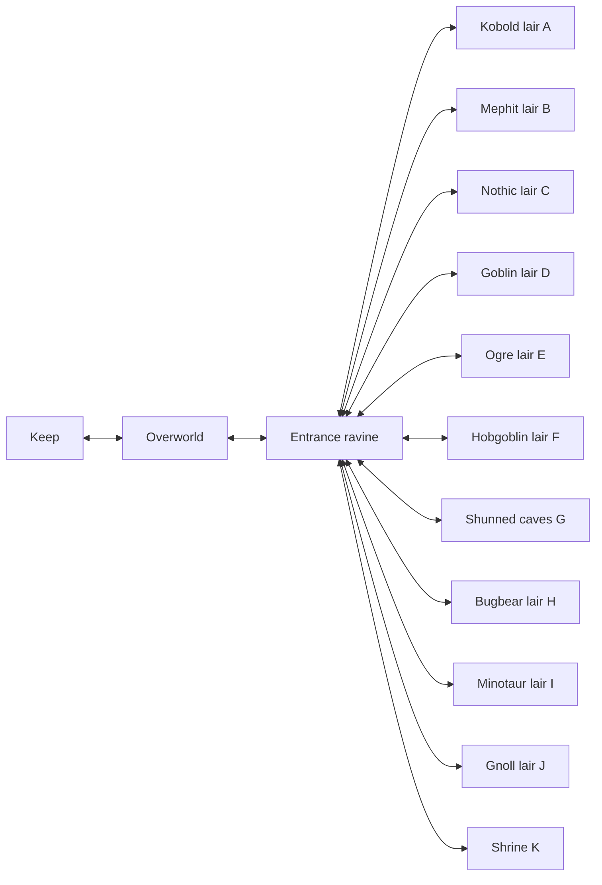

# Borderlands World Layout

Authored 2026-10-26. Campaign content version **0.2**, title **Heroes of the Borderlands**.

Current content update: version **0.3** adds a second four-kobold group in Cave A's eastern chamber and replaces its direct victory-stage jump with a two-objective quest. Warden dialogue and journal distinguish partial, ready and completed states. Layout/art remain as edited in Tiled. See [QUEST_OBJECTIVES.md](QUEST_OBJECTIVES.md); the table below describes the original world expansion.

The user requested a Keep, overworld, shared cave entrance, and eleven cave maps, retaining the current combat and existing game assets. All fourteen maps are installed and explorable. These are original layouts for quest development, not verified reproductions of the published room plans. Cave A retains the playable four-kobold quest; B–K currently provide connected room layouts, environmental landmarks and room descriptions for future quests/encounters.

## Connections

## Map Registry

2026-10-26 Tiled update: Keep is now 100×100 and overworld 80×120. The overworld biome layer has been rebuilt to cover the expanded terrain, including Forest, Grassland, Swamp, Water and Hills (shared lowest-level biome row, MaxMonsterLevel 5). The older dimensions/coordinates below describe the initial authored layout. Keep return-spawn connectivity currently fails automated verification; see BUGS.md.

All IDs below have prefix `map/borderlands/`. Files live in `Assets/DungeonEscape/Campaigns/borderlands/Maps/` and are registered in the campaign's `Data/maps.json`.

| ID / file stem | Size | Current layout |
| --- | --- | --- |
| `keep` | 40×32 | Walled courtyard, fortress, inn with 5-gold long rest, temple, provisioner and guild spaces. Warden remains near the initial spawn. Other NPCs provide directions; shops/contracts are future content. |
| `overworld` | 64×48 | Main trail between Keep and caves, Woods shortcut, Tamarack Stand clearing, Fens pools and signs. Hidden biome metadata distinguishes woodland, grassland and swamp. |
| `cave-entrance` | 64×44 | Shared entrance ravine. Northern mouths A–E, southern F–I, eastern J/K; directory, individual entrance tablets, return spawns and a western exit. |
| `cave` (A) | 32×28 | Kobold guard chamber plus stores and side rooms. Existing encounter ID `encounter/borderlands/entrance-kobolds`, count 4 and quest outcome unchanged. |
| `cave-b` | 32×28 | Mephit lair: stepped chambers and warm-spring room. |
| `cave-c` | 32×28 | Nothic lair: secluded study and looping side chambers. |
| `cave-d` | 32×28 | Goblin lair: linked barracks-style rooms and escape loop. |
| `cave-e` | 32×28 | Ogre lair: large den with side stores. |
| `cave-f` | 32×28 | Hobgoblin lair: orderly barracks/drill-yard loop. |
| `cave-g` | 32×28 | Shunned caves: abandoned rooms and a mossy den. |
| `cave-h` | 32×28 | Bugbear lair: staggered chambers and blind corners. |
| `cave-i` | 32×28 | Minotaur lair: central spine with two circling routes. |
| `cave-j` | 32×28 | Gnoll lair: gathering room and scavenged stores. |
| `cave-k` | 32×28 | Shrine of Evil Chaos: processional chambers and a ceremonial inner shrine. Finale mechanics remain future work. |

## Travel And Identity

- New games still begin at Keep `start` (7,10). Warden position and the Cave A monster footprint (7–8,3–4) remain stable for the existing quest tests.
- Keep's south gate (20,29) goes to overworld `from-keep`; returning uses Keep `gate` (20,27).
- Overworld's northeastern stairs (52,12) lead to ravine `from-overworld`; returning uses overworld `from-caves`.
- Every ravine entrance uses that cave's `start`; cave exits return to matching ravine `from-a` through `from-k`.
- Default spawns are unique; return spawns are separate from warp tiles to prevent immediate bounce-back.
- `OverworldMapId` now correctly identifies `map/borderlands/overworld`. Keep is an ordinary Town map. Overworld-boundary persistence therefore follows the actual outdoor travel map.
- The original campaign remains the installed default. Only the Borderlands content version changes, from 0.1 to 0.2, because the world topology/overworld contract changed. The existing compatibility rule rejects old 0.1 prototype saves rather than migrating them. Start a new Borderlands game.

## Assets And Scope

All map art references shared `outdoors`, `npc`, `dungeon`, `indoor`, `castle`, `overworld` and `biomes` tilesets through map-relative paths. Existing music is reused. There is no new raster art and no modified shared tileset. Maps use Tiled object `class`, not legacy `type` attributes. Tile properties may still use Tiled's normal primitive `type="bool"` syntax.

NPC conversations, lair signs and the quest journal describe the new route: Keep south gate → Borderlands trail northeast → entrance ravine → Cave A → return to the warden. There are no new random encounters or populated enemies in B–K yet. There is no new general rest policy, faction simulation or tactical combat work in this pass.

## Validation

- Shared content loading validates all fourteen registered maps and definitions.
- Core world tests flood-fill walkable geometry including solid tiles/NPCs/monster footprints, check every spawn and warp, verify named reciprocal returns, reject warp/spawn overlap and disconnected walkable areas, and verify all fourteen maps are reachable.
- The eleven cave wall plans are distinct; the Cave A encounter identity and exact roster are retained.
- Game Editor fresh and cached previews render all fourteen maps; contact sheet and large previews inspected under `TestResults/borderlands-world/`.
- Runtime quest tests now traverse authored map connections rather than creating synthetic direct warps. A separate Play Mode test visits all eleven caves, returns through the ravine, restores an overworld save and returns to the Keep.
- Solution build passed with zero warnings/errors; Core 287/287, Unity Edit Mode 17/17 and Play Mode 20/20 passed. Unity 6000.4.4f1 tests used an isolated project because the main editor is open. Human input/balance checks remain in `MANUAL_TESTS.md`.

## Next Content Work

Populate individual lairs with source-verified quests, NPC conversations, encounters and rewards. Add Keep contracts and actual provisioner stock, meaningful wilderness events, secrets and the shrine finale. The map network is ready for that content; the campaign is not yet a complete adventure.
